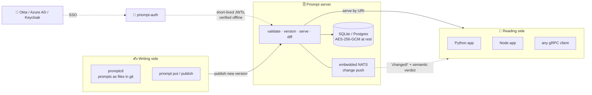
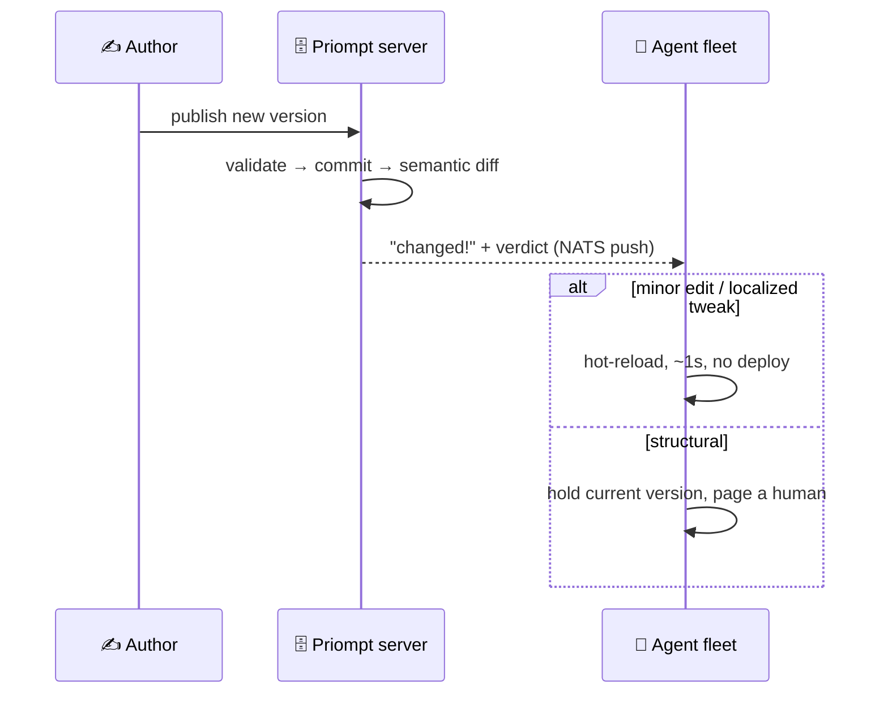

<div align="center">

# Priompt

### Git for your AI prompts — with a diff that understands *meaning*

Versioned. Validated. Served by address. Pushed live to every agent using them.


</div>

---

## The problem

You change one line of a prompt. Ship it. Three hours later, support tickets.

Nobody knows what the prompt said yesterday, which agent read the old one, or
whether the edit that broke it was the tone change or the sentence someone added
above it. There is no `git log` for the thing that actually decides your product's
behavior.

Today teams handle prompts in one of three ways, and all three fail the same way:

| How it's done today | Where it breaks |
| --- | --- |
| **Hardcoded in source** | Changing a prompt means a code review, a build, and a deploy. Non-engineers can't touch it, so they don't — the prompt rots. |
| **A doc, a YAML file, a spreadsheet** | No history, no validation, no rollback. Two services silently read different copies. |
| **A hosted prompt SaaS** | Your prompts — the actual IP of an AI product — live on someone else's servers. Diffs are text diffs: a typo fix and a policy inversion look identical. |

None of them can answer the only question that matters at 3am: **did this edit
change what the prompt *means*, and who is running it right now?**

---

## What Priompt does

A prompt becomes a small versioned record at an address:

```
priompt://acme/onboarding/welcome
```

A template with `{placeholders}`, its declared slots, and a content hash. Agents
fetch it by address instead of hard-coding it. Authors publish new versions through
a validation gate. Every version is a commit — with branches, merges, rollback, and
pinning. Exactly like a file in Git, per prompt.



---

## What's novel

### 1. The Semantic Propagation Diff

Every other tool asks *"did the text change?"* — or at best, *"how similar are these
two prompts overall?"* Both are the wrong question. A whole-prompt similarity score
drowns a surgical policy inversion in 400 lines of unchanged context.

Priompt asks a sharper one: **how far does the meaning shift travel?**

For each changed hunk it computes three signals:

| | Signal | What it measures |
| --- | --- | --- |
| **1** | The changed region | The line-level hunk itself |
| **2** | Point delta | Meaning shift *at* the edit — `1 − cosine(old, new)` |
| **3** | Propagation profile | Expand the window outward — ±2, ±4, ±6 lines, **up and down independently** — recomputing the delta at each step, until the curve flattens or hits the prompt boundary |

Signal 3 is the idea. An edit whose meaning shift **decays** as context grows is
self-contained. An edit whose shift **persists** all the way to the boundary is
reshaping how the whole prompt reads.

```text
  semantic delta
      │
  0.5 ┤ ●━━━●━━━●━━━●━━━●   🔴 structural — the ripple persists to the boundary
      │ ┃
      │ ┃
  0.3 ┤ ●
      │  ╲
  0.1 ┤   ●╲___
      │       ●───●───●     🟡 localized tweak — the ripple decays
  0.0 ┼───┬───┬───┬───┬──
      0  ±2  ±4  ±6  ±8     context window (lines)
```

Two edits with the **same** point delta, opposite verdicts:

| Verdict | Shape | What it means |
| --- | --- | --- |
| 🟢 `minor edit` | Low delta, flat curve | Typo, whitespace, synonym. Ship it. |
| 🟡 `localized tweak` | High delta, decaying curve | Real change, contained to its region. Ship it. |
| 🔴 `structural` | High delta, persistent to boundary | The prompt now means something else. **A human looks at this.** |

Embeddings are a swappable primitive, not the product — the propagation, adaptive
windowing, and classification are what's new. It runs **offline** out of the box
with a lexical embedder (self-calibrating: bag-of-words distance dilutes as the
window grows, so the offline path lowers its own structural bar to compensate).
Point it at any OpenAI-compatible embeddings endpoint — Ollama, TEI, llama.cpp — for
true meaning-level judgment. No API key required, ever.

### 2. The verdict travels with the change

This is the part that makes the diff more than a report.

Publishing does four things in one atomic step: store the version, run the diff,
invalidate caches, and **push a notification carrying the verdict** to every
subscribed agent. Your agents don't poll and they don't guess — they receive the
classification and act on it themselves.



```python
def on_change(version, classification):
    if classification == "structural":
        alert_a_human(version)      # hold the line
    else:
        reload(version)             # safe, automatic

client.subscribe("priompt://acme/support/agent", on_change)
```

Version control tells you what changed. Semantic classification tells you whether
it's dangerous. Live distribution makes it act. **Priompt is the only place all
three close into one loop** — that loop is the project.

### 3. Three more things that aren't obvious

- **The validation gate runs on write *and* on read.** An undeclared
  `{placeholder}`, an empty template, an unused slot — cannot be stored, and cannot
  be served either. A prompt that got in some other way still can't get out.
- **Auth and serving never share fate.** `priompt-auth` mints short-lived EdDSA
  JWTs; the server verifies them **offline** against cached JWKS keys. The auth
  service going down does not stop a single prompt from being served.
- **Rollback is a pointer move.** `SetBranch(uri, "main", old_commit)` is atomic.
  Every unpinned agent converges by push or within one cache TTL. No redeploy.

---

## The repos

| Repo | Ships | What it does |
| --- | --- | --- |
| [**priompt**](https://github.com/priompt/priompt) | `priompt` binary | **Start here.** Stores, versions, validates, serves and distributes prompts over gRPC, with an embedded NATS broker for change push. One binary is both server and ops CLI |
| [**proto**](https://github.com/priompt/proto) | Go module `priomptproto` | The single source of truth: the gRPC contract + stubs, JWT claims, validation rules, and the semantic diff engine. Imported, never copied |
| [**auth**](https://github.com/priompt/auth) | `priompt-auth` binary + `authn` package | Trades corporate SSO logins (OIDC) or service-account secrets for short-lived EdDSA JWTs, verified offline by the server |
| [**cli**](https://github.com/priompt/cli) | `promptctl` binary | The writing desk: prompts as files in a git repo, validated on commit, semantically diffed before shipping, promoted dev→prod as branches |
| [**python-sdk**](https://github.com/priompt/python-sdk) | Python client | `get` / `list` / `diff` / `subscribe`, with optional local cache and version pinning |
| [**js-sdk**](https://github.com/priompt/js-sdk) | Node client | The same for Node, plus `publish` — no codegen, the proto loads at runtime |
| [**db-adapters**](https://github.com/priompt/db-adapters) | Go module `priomptdb` | The storage engine as a reusable library: SQLite and PostgreSQL behind one API, optional AES-256-GCM encryption at rest |

**Only the server is required.** Add the CLI when authors want a git workflow, the
auth service when the enterprise asks for SSO, Postgres and Redis when one node
isn't enough. Same binaries, same addresses, hobbyist to enterprise — growing is
only ever *adding a flag*.

Two pieces work with no server at all: `priomptdb` (versioned encrypted storage as a
library) and `priomptproto` (the validation and semantic-diff engines as libraries).

---

## Five minutes

```sh
git clone https://github.com/priompt/priompt && cd priompt
go build -o priompt ./cmd/priompt

echo "Hi {name}, welcome to {org}!" > welcome.txt
./priompt put -uri priompt://acme/onboarding/welcome -file welcome.txt -slot name -slot org
./priompt serve -addr :8443
```

```python
from priompt import PromptClient
p = PromptClient(host="localhost:8443").get("priompt://acme/onboarding/welcome")
print(p.template.format(name="Sujal", org="Acme"))
# -> Hi Sujal, welcome to Acme!
```

`put` works with **no server running** — it writes straight to the SQLite file. The
smallest useful deployment is a validated, versioned prompt store in a single file.
Or `docker compose up` in [priompt](https://github.com/priompt/priompt) for a
container with persistent storage.

---

## Status

**Working software, pre-release.** All 22 end-to-end suites pass. Registry names
(Docker / PyPI / npm), public Go module paths, and the license are the last items
before a first public release — until then, clone the repos side by side and build
from source.

---

<div align="center">

### Maintainers

<table>
<tr>
<td align="center" width="180">
<a href="https://github.com/sujal-maheshwari2004">
<br>
<b>Sujal Maheshwari</b><br>
<sub>@sujal-maheshwari2004</sub>
</a>
</td>
<td align="center" width="180">
<a href="https://github.com/iamDyeus">
<br>
<b>Arsh</b><br>
<sub>@iamDyeus</sub>
</a>
</td>
</tr>
</table>

Open source and self-hosted. Issues and PRs welcome on any repo — start with
[**priompt**](https://github.com/priompt/priompt) if you're not sure where a change belongs.

</div>
