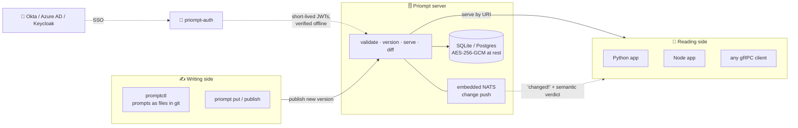

# Priompt

**Git for your AI prompts** — versioned, validated, served by address, and pushed
live to every agent using them.

If you have ever changed a prompt, broken an agent in production, and had no idea
what the old prompt said: that is the problem this fixes. Teams solved it for code
long ago — code lives in Git, every change is recorded, you can always roll back.
Priompt does the same job for **prompts**, plus two things Git can't do:

1. **A semantic diff** that judges what an edit *means* — a harmless rewording, or
   a structural change that rewires the prompt's behavior?
2. **Live distribution** — running agents are notified the instant a prompt
   changes, *with that verdict attached*, so they hot-reload safe edits and hold
   risky ones for a human.

Self-hosted, open source, one binary to start.

## How it fits together



A prompt is a small versioned record at an address like
`priompt://acme/onboarding/welcome`: a template with `{placeholders}`, the declared
slots, and a content hash. Agents fetch it by address instead of hard-coding it;
authors publish new versions through a validation gate; every version is a commit
with branches, merges, rollback, and pinning — exactly like a file in Git, per
prompt.

## The repos

| Repo | Ships | What it does |
| --- | --- | --- |
| [**priompt**](https://github.com/priompt/priompt) | `priompt` binary | **Start here.** The core: stores, versions, validates, serves and distributes prompts over gRPC, with an embedded NATS broker for change push. One binary is both server and ops CLI |
| [**proto**](https://github.com/priompt/proto) | Go module `priomptproto` | The single source of truth everything imports: the gRPC contract + stubs, the JWT claims, the validation rules, and the semantic diff engine |
| [**auth**](https://github.com/priompt/auth) | `priompt-auth` binary + `authn` package | Trades corporate SSO logins (OIDC) or service-account secrets for short-lived EdDSA JWTs. The server verifies them offline via cached JWKS, so issuing and serving never share fate |
| [**cli**](https://github.com/priompt/cli) | `promptctl` binary | The writing desk: prompts as plain files in a git repo, validated on commit, semantically diffed before shipping, promoted dev→prod as branches |
| [**python-sdk**](https://github.com/priompt/python-sdk) | Python client | What a Python agent imports: `get` / `list` / `diff` / `subscribe`, with optional local cache and version pinning |
| [**js-sdk**](https://github.com/priompt/js-sdk) | Node client | The same for Node: `get` / `diff` / `publish` / `subscribe` — no codegen, the proto loads at runtime |
| [**db-adapters**](https://github.com/priompt/db-adapters) | Go module `priomptdb` | The storage engine as a reusable library: SQLite (default) and PostgreSQL behind one API, optional AES-256-GCM encryption at rest |

Only the server is required. Everything else is opt-in: add the CLI when authors
want a git workflow, the auth service when the enterprise asks for SSO,
Postgres/Redis when one node isn't enough — same binaries and same addresses at
every scale.

## What you get

- **Validation gate** — a malformed prompt (undeclared `{placeholder}`, empty
  template, unused slot) cannot be stored *or served*; the same rules run on write
  and on read.
- **Versioning** — every publish is a commit with author, message, and parents.
  Branches are invisible to agents until merged; rollback is an atomic pointer
  move; agents can pin an exact commit.
- **Semantic propagation diff** — how big is the meaning-shift at the edit, and how
  far does it ripple? Verdicts: `minor edit`, `localized tweak`, `structural`.
  Works offline out of the box; point it at any OpenAI-compatible embeddings
  endpoint (Ollama, TEI, llama.cpp) for real meaning-level judgment.
- **Pub/sub with verdicts** — publish stores the version, invalidates caches, and
  pushes a notification carrying the verdict to every subscriber. This is what
  makes safe auto-reload possible.
- **Auth that grows** — open for local dev, a static tokens file with org scoping
  and expiry, or full SSO via priompt-auth. All three coexist.
- **Ops** — SQLite or Postgres, Redis L2 cache, JSONL backup/restore, schema
  migrations, encryption at rest, TLS and mTLS, Prometheus metrics, audit logs,
  per-org rate limiting.

## Five minutes

```sh
git clone https://github.com/priompt/priompt && cd priompt
go build -o priompt ./cmd/priompt

echo "Hi {name}, welcome to {org}!" > welcome.txt
./priompt put -uri priompt://acme/onboarding/welcome -file welcome.txt -slot name -slot org
./priompt serve -addr :8443
```

```python
from priompt import PromptClient
p = PromptClient(host="localhost:8443").get("priompt://acme/onboarding/welcome")
print(p.template.format(name="Sujal", org="Acme"))
# -> Hi Sujal, welcome to Acme!
```

Or `docker compose up` in the [priompt](https://github.com/priompt/priompt) repo
for a containerized server with persistent storage.

## Status

**Working software, pre-release.** All 22 end-to-end suites pass. Registry names
(Docker/PyPI/npm), public Go module paths, and the license are the last items
before a first public release — until then, clone the repos side by side and build
from source.

## Maintainers

| | |
| --- | --- |
| <a href="https://github.com/sujal-maheshwari2004"></a> | **Sujal Maheshwari** — [@sujal-maheshwari2004](https://github.com/sujal-maheshwari2004) |
| <a href="https://github.com/iamDyeus"></a> | **Arsh** — [@iamDyeus](https://github.com/iamDyeus) |

Issues and PRs are welcome on any repo. Start with
[priompt](https://github.com/priompt/priompt) if you're not sure where a change
belongs.
